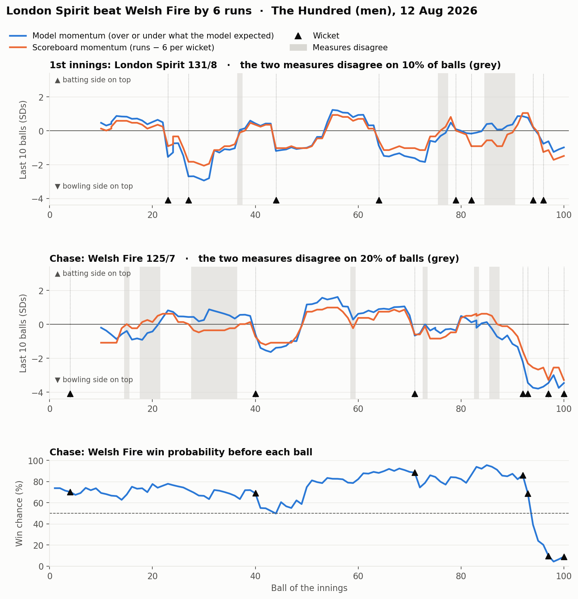

# Momentum in Cricket

**Is momentum in short-form cricket real?** A ball-by-ball study of The Hundred (men and women, 2021–2026). It uses a pre-registered analysis plan, out-of-sample testing and a confirmation on fresh competitions.

📊 **Interactive dashboard:** [Momentum in Cricket](https://claude.ai/artifact/1xhodHXQFg7VYJapf3Zijv) (General and Deep analysis)
📄 **Full report:** [reports/Momentum_in_The_Hundred_results.pdf](reports/Momentum_in_The_Hundred_results.pdf)



## How it works

1. **Every ball.** Cricsheet's open ball-by-ball records.
2. **What was known.** 47–48 features known before each ball: match state, batter and partnership, recent play, player history.
3. **What should happen.** A model (LightGBM averaged with a random forest, trained only on earlier seasons) gives the chance of a wicket, 0, 1, 2, 3, 4 or 6.
4. **Better or worse?** Each ball's value is compared with what was expected: runs in the 1st innings, win probability in a chase.
5. **Momentum** = actual minus expected value, summed over the last 10 balls.

## Main findings (frozen before analysis)

| Question | Men | Women |
|---|---|---|
| Does a trend describe play better than a single ball? | Yes (R² 0.035 → 0.40) | Yes (0.032 → 0.36) |
| Does team momentum carry forward as streaks? | No: form on the day | No: form on the day |
| Is model momentum better than scoreboard momentum, especially in chases? | Yes | Yes |
| Do coaching decisions change momentum (propensity-score matching)? | No effect found | No effect found |
| Do men and women differ? | No significant difference | |
| **Do batters run hot over 5 balls? (fresh data, test written before download)** | **Confirmed (T20 Blast)** | **Confirmed (English women's T20)** |

Every finding holds when the model is rebuilt with player history from 21 T20 competitions ([robustness check](data/out/compare/v2_vs_v1.csv)).

## Deep analysis (exploratory: found after the plan, to be confirmed)

- **The free hit is undervalued.** The ball after a no-ball beats expectation by about +0.3 SD.
- **Spin in the first 20 balls costs runs (men)**, even when the model knows the players.
- **Matches are won at the end of the chase.** The last 20 balls go most closely with the result.
- **Honest nulls:** boundaries don't cluster beyond the situation; bowler phase specialists are mostly noise; weather doesn't help prediction.
- **Better information beat a better algorithm:** a batter's record against pace and spin helped more than any change of model.

## Reproduce

```bash
pip install -r requirements.txt
# download Cricsheet JSON zips (hnd_male, hnd_female; for confirmation and history also ntb_male, cec_female,
# wtb_female and the leagues listed in src/history_pool.py) into data/raw/<code>/
python src/pipeline.py            # main frozen analysis, men and women
python src/confirm.py             # fresh-data confirmation of the batter hot hand
python src/player_styles.py       # bowling type and batting hand (Wikipedia, via the Cricsheet register)
python src/history_pool.py && python src/history_features.py
python src/conditions.py && python src/feature_lab.py
python src/deep_analysis.py && python src/v2_sensitivity.py
python src/export_dashboard.py && python src/deep_figures.py && python src/make_report.py
```

[CODE_GUIDE.md](CODE_GUIDE.md) walks through every script. [ANALYSIS_PLAN.md](ANALYSIS_PLAN.md) and [CONFIRMATION_PLAN.md](CONFIRMATION_PLAN.md) are the frozen plans, with every deviation logged.

## Data and credits

- Ball-by-ball data: [Cricsheet](https://cricsheet.org), [Open Data Commons Attribution License](http://opendatacommons.org/licenses/by/1.0/).
- Bowling type and batting hand: Wikipedia infoboxes (CC BY-SA), matched through the Cricsheet register and Wikidata.
- Weather: [Open-Meteo](https://open-meteo.com) historical archive (CC BY 4.0).
- No club or private data is used.
